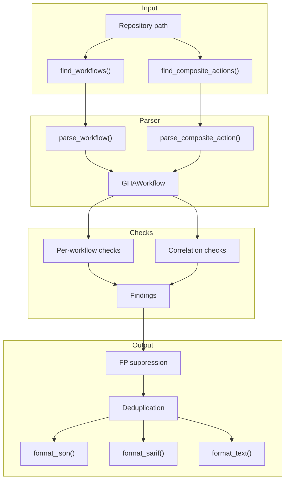

# Architecture Overview

github-guard follows a pipeline architecture: parse, check, format.

## Pipeline

## Components

### Parser (`parser.py`)

The parser uses `ruamel.yaml` (round-trip mode) to load workflow YAML while preserving line numbers. It produces a normalized data model:

- **`GHAWorkflow`**: top-level workflow with name, triggers, permissions, env, and jobs
- **`GHAJob`**: individual job with runs-on, permissions, environment, timeout, steps, and reusable workflow call info
- **`GHAStep`**: individual step with uses, run, with, env, and if condition

Key behaviors:

- `normalize_triggers()` handles all `on:` forms (string, list, dict)
- Composite actions (`action.yml`) are modeled as single-job workflows with a `composite_action` trigger for uniform check processing
- Both `.github/workflows/*.yml` and `action.yml`/`action.yaml` files are discovered

### Check Registry (`checks/_common.py`)

Checks register themselves via decorators:

- `@register_check`: per-workflow checks that receive a single `GHAWorkflow`
- `@register_correlation_check`: cross-workflow checks that receive all `GHAWorkflow` objects

Each check function returns a list of finding dicts. The `_finding()` helper ensures consistent structure with rule_id, severity, title, file, line, message, CWE, remediation, and docs_url.

### Check Modules

| Module | Checks | Focus |
|--------|--------|-------|
| `triggers.py` | GHA-TRIG-001..003 | Trigger abuse: PRT fork checkout, bypassable gates, dispatch injection |
| `permissions.py` | GHA-PERM-001..002 | Permission escalation: missing permissions, OIDC token misuse |
| `pinning.py` | GHA-PIN-001..002 | Supply chain: unpinned actions, unpinned container images |
| `secrets.py` | GHA-SEC-001..003 | Secret hygiene: hardcoded creds, secrets as inputs, artifact upload |
| `runners.py` | GHA-RUN-001..002 | Runner security: self-hosted without protection, missing timeouts |
| `flow.py` | GHA-FLOW-001..003 | Workflow flow: workflow_run chains, composite action refs, secrets:inherit |

### Config (`config.py`)

`ScannerConfig` holds configurable safe lists and check settings:

- `skip_checks`: list of rule IDs to disable
- `min_severity`: minimum severity threshold
- `trusted_action_owners`: action owners considered safe (e.g., `actions`, `github`)
- `known_oidc_actions`: actions that legitimately consume OIDC tokens
- `github_hosted_patterns`: runner label patterns for GitHub-hosted runners
- `secret_patterns`: string prefixes that indicate hardcoded credentials

Configuration is loaded from a YAML file via `--config`.

### Formatter (`formatter.py`)

Three output formats:

- **JSON**: full findings with summary by severity and category
- **SARIF 2.1.0**: standard static analysis format for GitHub Code Scanning integration
- **Text**: human-readable with per-finding details and severity summary

### CLI (`cli.py`)

Entry point that wires everything together:

1. Parse arguments
2. Load config
3. Parse target (file or directory)
4. Run checks
5. Apply baseline (if provided)
6. Format and output
7. Determine exit code based on findings and threshold

## Design Decisions

**Why per-file checks + correlation checks?** Most security issues are within a single workflow, but some (like `workflow_run` chains) require cross-file analysis. The two-tier registry keeps single-file checks simple while enabling cross-workflow correlation.

**Why model composite actions as workflows?** Using a unified `GHAWorkflow` type for both workflows and composite actions means check functions work on both without special cases. The `composite_action` pseudo-trigger distinguishes them when needed.

**Why ruamel.yaml round-trip mode?** Preserving line numbers is critical for accurate finding locations. ruamel.yaml's `lc` (line/column) attributes on parsed nodes provide this.
