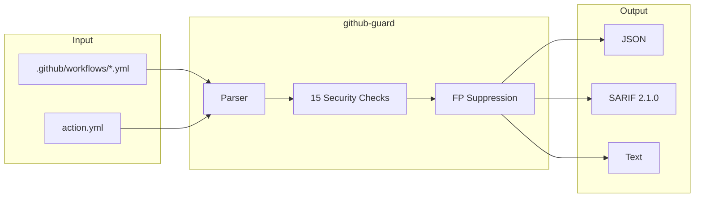

# github-guard

Static security scanner for GitHub Actions workflows

[Get Started](getting-started/installation.md){ .md-button .md-button--primary }
[GitHub](https://github.com/ugiordan/github-guard){ .md-button }

---

## How It Works

github-guard parses GitHub Actions workflow YAML files and composite actions, running 16 security checks across 6 categories. It catches trigger abuse, permission escalation, supply chain risks, secret hygiene issues, runner misconfigurations, and workflow flow vulnerabilities.



**Pipeline:**

1. **Parser** loads workflow YAML with ruamel.yaml, handles trigger normalization, composite actions, and reusable workflow calls
2. **16 Security Checks** across 6 categories detect trigger abuse, permission escalation, unpinned refs, secrets exposure, runner risks, and flow issues
3. **FP Suppression** filters `workflow_call`-only workflows, trusted triggers, `${{ secrets.* }}` references, and configurable safe lists

---

## Quick Example

```bash
$ github-guard . --format text
```

```
GitHub Actions Security Scan: my-project
Found 4 issue(s)

[CRITICAL] GHA-TRIG-001: pull_request_target with fork checkout
  File: .github/workflows/ci.yml:15
  Job 'build' checks out fork code (ref: ${{ github.event.pull_request.head.sha }})
  in a pull_request_target workflow.
  Fix: Use pull_request trigger instead, or avoid checking out fork code.

[HIGH] GHA-PERM-001: Missing permissions block
  File: .github/workflows/ci.yml:1
  Workflow has no top-level permissions and not all jobs define permissions.
  Fix: Add a top-level 'permissions: {}' to restrict to read-only by default.

Summary: 1 CRITICAL, 1 HIGH, 2 MEDIUM
```

Generate SARIF for GitHub Code Scanning:

```bash
github-guard /path/to/repo --format sarif --output results.sarif
```

---

## Features

<div class="grid cards" markdown>

-   :material-shield-alert:{ .lg .middle } **Trigger Abuse Detection**

    ---

    Detects `pull_request_target` + fork checkout (CRITICAL), bypassable fork detection gates, and `workflow_dispatch` command injection.

-   :material-link-lock:{ .lg .middle } **Supply Chain Pinning**

    ---

    Flags unpinned action references (mutable tags like `v4`) and unpinned container images (`:latest` or missing tags). Validates composite actions.

-   :material-key:{ .lg .middle } **Secret Hygiene**

    ---

    Finds hardcoded credentials via pattern matching, secrets passed as workflow inputs instead of the `secrets:` key, and artifact uploads in PR target context.

-   :material-source-branch:{ .lg .middle } **Cross-Workflow Analysis**

    ---

    Correlation checks detect `workflow_run` triggered by fork-triggerable workflows, tracing data flow risks across workflow boundaries.

</div>

---

## What Gets Detected

16 checks across 6 categories:

| Category | Checks | Examples |
|----------|--------|---------|
| **Triggers** | GHA-TRIG-001..004 | `pull_request_target` + fork checkout, bypassable fork detection, `workflow_dispatch` injection, expression injection via attacker-controlled context |
| **Permissions** | GHA-PERM-001..002 | Missing permissions block, `id-token:write` without OIDC consumer |
| **Pinning** | GHA-PIN-001..002 | Unpinned action references, unpinned container images |
| **Secrets** | GHA-SEC-001..003 | Hardcoded credentials, secrets as workflow inputs, artifact upload in PR context |
| **Runners** | GHA-RUN-001..002 | Self-hosted runners without environment protection, jobs without timeout |
| **Flow** | GHA-FLOW-001..003 | `workflow_run` from fork-triggerable source, composite action unpinned refs, `secrets:inherit` |

See [Detection Rules](reference/rules.md) for the full reference.

---

## Next Steps

<div class="grid cards" markdown>

-   [Installation Guide](getting-started/installation.md)
-   [Quick Start Tutorial](getting-started/quickstart.md)
-   [CI Integration](guides/ci-integration.md)
-   [Detection Rules Reference](reference/rules.md)

</div>
